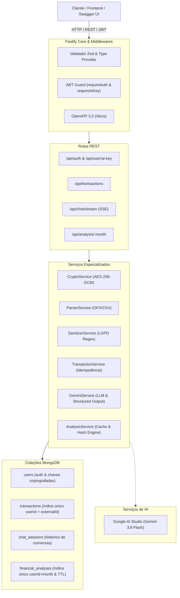
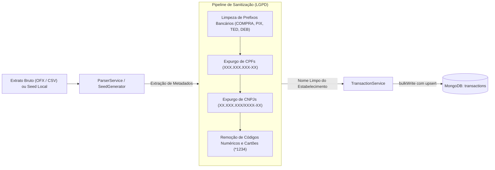
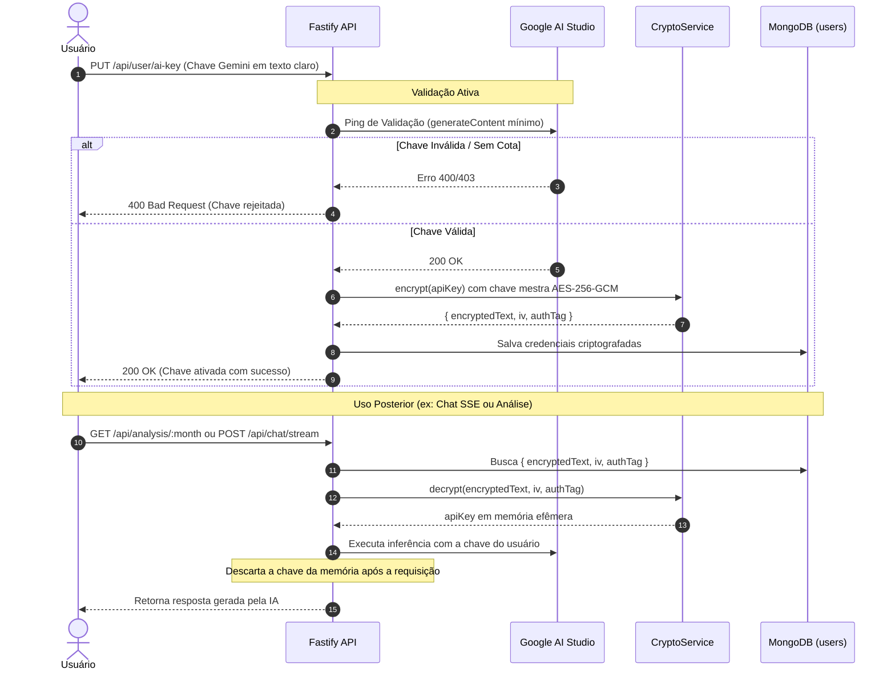
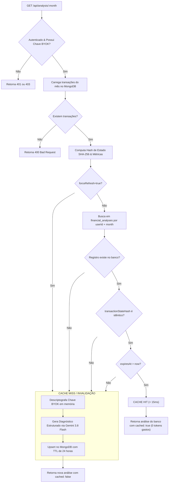

# Financial Intelligence Backend API 🚀

[](https://nodejs.org/)
[](https://www.typescriptlang.org/)
[](https://fastify.dev/)
[](https://www.mongodb.com/)
[](https://www.docker.com/)
[](https://github.com/)

Backend financeiro de alta performance construído com **Node.js 20 LTS**, **TypeScript estrito** e **Fastify**, projetado sob a filosofia **BYOK (Bring Your Own Key)** e estrita conformidade com a **LGPD**. 

A plataforma consolida transações bancárias via arquivos de extrato (**OFX SGML**, **CSV**) e gerador autônomo local de dados sintéticos para desenvolvimento e demonstrações, executando classificação orçamentária inteligente, consultoria financeira interativa em streaming via **Server-Sent Events (SSE)** e diagnósticos analíticos com **cache nativo de 24 horas no MongoDB**.

---

## 📑 Sumário

- [Visão Geral & Proposta de Valor](#-visão-geral--proposta-de-valor)
- [Princípios de Arquitetura](#-princípios-de-arquitetura)
- [Diagramas Arquiteturais](#-diagramas-arquiteturais)
  - [1. Visão Geral da Arquitetura em Camadas](#1-visão-geral-da-arquitetura-em-camadas)
  - [2. Fluxo de Ingestão e Sanitização LGPD](#2-fluxo-de-ingestão-e-sanitização-lgpd)
  - [3. Ciclo de Vida de Segurança BYOK (AES-256-GCM)](#3-ciclo-de-vida-de-segurança-byok-aes-256-gcm)
  - [4. Estratégia de Cache de Análise com TTL e Invalidação Determinística](#4-estratégia-de-cache-de-análise-com-ttl-e-invalidação-determinística)
- [Módulos do Sistema](#-módulos-do-sistema)
- [Variáveis de Ambiente](#-variáveis-de-ambiente)
- [Guia de Instalação e Execução](#-guia-de-instalação-e-execução)
  - [Execução com Docker Compose (Recomendado)](#execução-com-docker-compose-recomendado)
  - [Execução em Desenvolvimento Local](#execução-em-desenvolvimento-local)
  - [Automação de Seed de Dados de Teste](#automação-de-seed-de-dados-de-teste)
- [Catálogo de Endpoints (API Reference)](#-catálogo-de-endpoints-api-reference)
- [Testes e Verificação de Qualidade](#-testes-e-verificação-de-qualidade)

---

## 💡 Visão Geral & Proposta de Valor

- **Custo Operacional Zero com IA (BYOK)**: Cada usuário fornece sua própria chave de API do **Google AI Studio (Gemini)**. O servidor nunca arca com faturas de IA e as chaves são protegidas com criptografia de padrão militar **AES-256-GCM**.
- **Minimização Extrema de Tokens**: Pré-processamento local agressivo que deduplica nomes comerciais e resume métricas matemáticas no backend antes de acionar o LLM, economizando até **95% dos tokens** em comparação com abordagens tradicionais.
- **Cache Persistente com TTL (24h)**: Diagnósticos financeiros mensais persistem no MongoDB com índice TTL nativo e invalidação determinística por hash de estado (`transactionStateHash`), eliminando requisições redundantes ao Gemini e entregando respostas em `< 15ms`.
- **Privacidade e LGPD por Design**: Remoção cirúrgica de PII (CPFs, CNPJs, códigos de transação, dados de cartões) antes de qualquer persistência ou tráfego para provedores de inteligência artificial.
- **Automação de Testes Plug & Play**: Script de seed determinístico e 100% offline (`npm run seed`) com provisionamento automático da chave do `.env`, 35+ transações em múltiplos meses cobrindo todas as 7 categorias canônicas e pré-aquecimento do cache de análise.

---

## 🏛 Princípios de Arquitetura

O projeto segue rigorosamente os 7 princípios definidos na Constituição Técnica v2.0.0:

| Princípio | Implementação Técnica |
|---|---|
| **I. Escopo Estrito de Backend** | API REST pura com Fastify e TypeScript estrito (`strict: true`, sem uso de `any`). |
| **II. Stack Tecnológica Sem Dependências Relacionais** | Persistência exclusiva no **MongoDB 7.0 (NoSQL)** via Mongoose; sem Redis e sem bancos relacionais adicionais. |
| **III. Arquitetura BYOK & Custo Zero** | Chaves do Google AI Studio validadas ativamente via ping, salvas criptografadas com `AES-256-GCM` e descriptografadas apenas em memória no ciclo de vida da requisição. |
| **IV. Minimização Extrema de Tokens** | Agrupamento de estabelecimentos comerciais, Structured Outputs com JSON Schema e cache persistente com TTL. |
| **V. Ingestão de Extratos e Provedor Local Sintético** | Ingestão robusta de extratos bancários manuais (OFX SGML, CSV com detecção de encoding UTF-8 / Windows-1252) e gerador local autônomo de dados de teste (Seed), sem dependências de APIs externas de Open Finance. |
| **VI. Containerização Integral** | Configuração completa em `docker-compose.yml` multi-container (Fastify API + MongoDB Replica/Single com healthchecks integrados). |
| **VII. Autenticação Stateless e LGPD** | JWT stateless, multi-tenancy rigoroso com isolamento por `userId` e expurgo de PII em memória. |

---

## 📐 Diagramas Arquiteturais

### 1. Visão Geral da Arquitetura em Camadas



---

### 2. Fluxo de Ingestão e Sanitização LGPD



---

### 3. Ciclo de Vida de Segurança BYOK (AES-256-GCM)



---

### 4. Estratégia de Cache de Análise com TTL e Invalidação Determinística



---

## 📦 Módulos do Sistema

### 1. Autenticação Stateless (JWT) & Gestão BYOK
- Registro (`POST /api/auth/register`) e login (`POST /api/auth/login`) com senhas hashificadas via `bcryptjs`.
- Endpoint dedicado `PUT /api/user/ai-key` para configuração da chave do Gemini, com ping ativo antes da aceitação.
- Criptografia com algoritmo autenticado `aes-256-gcm` (vetor de inicialização de 12 bytes e tag de autenticação de 16 bytes).

### 2. Ingestão de Extratos Bancários (OFX & CSV) e Edição Manual
- Upload de arquivos via `multipart/form-data` (`POST /api/transactions/upload`).
- Parser resiliente de arquivos **OFX SGML** e **CSV** (suporte para separadores `;` ou `,` e detecção de charset Windows-1252 / UTF-8).
- Novas transações importadas recebem por padrão o status inicial **Não Categorizado**, sinalizando pendência de classificação.
- Edição manual parcial via `PATCH /api/transactions/:id` protegida por JWT, permitindo ao usuário atualizar a categoria (restrita ao catálogo canônico) e a descrição amigável (`cleanDescription`) com estrito isolamento multi-tenant (retorna 404 se pertencer a outro usuário).
- Deduplicação determinística no banco baseada na combinação única `{ userId, externalId }`, preservando edições prévias do usuário.

### 3. Categorização Inteligente Pré-LLM
- `POST /api/transactions/categorize`: Extrai estabelecimentos únicos pendentes de categorização (`Não Categorizado`).
- Envia apenas a lista deduplicada de nomes para o Gemini com JSON Schema estrito nas categorias canônicas da plataforma: **Alimentação**, **Transporte**, **Moradia**, **Saúde**, **Lazer**, **Educação**, **Receita**, **Outros** e **Não Categorizado**.
- Reassociação em massa no MongoDB via `bulkWrite`.

### 4. Consultoria Financeira Conversacional (Chatbot SSE)
- `POST /api/chat/stream`: Stream contínuo em tempo real via Server-Sent Events (`text/event-stream`).
- Injeção automática do resumo financeiro consolidado do mês atual no prompt de sistema (`systemInstruction`).
- Persona de planejador financeiro CFP® empático, prático e construtivo, focado na realidade financeira brasileira.

### 5. Cache Inteligente de Análises com TTL e Invalidação por Hash
- `GET /api/analysis/:month`: Diagnóstico mensal detalhado, métricas de taxa de poupança e recomendações priorizadas.
- Índice TTL nativo do MongoDB (`expiresAt: 1`, `expireAfterSeconds: 0`) para limpeza automática após 24 horas.
- Invalidação automática e imediata caso novas transações sejam adicionadas ou valores alterados no mês informado.

### 6. Script de Seed 100% Local e Autônomo
- `npm run seed`: Provisionamento automático do usuário de testes `teste.usuario@exemplo.com`, integração da chave do `.env`, geração sintética de dezenas de transações brasileiras em múltiplos meses cobrindo todas as categorias canônicas e pré-aquecimento do cache de análise.

---

## 🔑 Variáveis de Ambiente

Crie um arquivo `.env` na raiz do projeto com base no modelo abaixo:

```env
# Porta e Host do Servidor Fastify
PORT=3000
HOST=0.0.0.0
NODE_ENV=development

# URI de Conexão com o MongoDB
MONGODB_URI=mongodb://localhost:27017/financial_db

# Segredo para assinatura de Tokens JWT (mínimo 32 caracteres)
JWT_SECRET=super_secret_jwt_key_dashboard_sdd_financial_2026

# Chave mestra para criptografia AES-256-GCM das chaves BYOK (exatamente 32 caracteres ASCII ou 64 hexadecimais)
ENCRYPTION_KEY=0123456789abcdef0123456789abcdef0123456789abcdef0123456789abcdef

# Chave Padrão do Google AI Studio para testes e seed (obtida em https://aistudio.google.com/)
GOOGLE_GENERATIVE_AI_API_KEY=AIzaSy...

# [OPCIONAL] Client ID do Google OAuth 2.0 para validação de audiência (aud) dos tokens
GOOGLE_CLIENT_ID=
```

> [!NOTE]
> O arquivo `.env` está configurado no `.gitignore` e no `.dockerignore` para prevenir qualquer vazamento acidental de chaves secretas.

---

## 🚀 Guia de Instalação e Execução

### Execução com Docker Compose (Recomendado)

A infraestrutura completa (API Fastify + MongoDB 7.0) pode ser inicializada com um único comando:

```bash
# 1. Clone o repositório
git clone <URL_DO_REPOSITORIO>
cd projeto-backend-dashboard-sdd

# 2. Configure seu arquivo .env
cp .env.example .env # ou configure suas variáveis no .env

# 3. Suba os containers em segundo plano
docker compose up --build -d

# 4. Verifique os logs da aplicação
docker compose logs -f api
```

A API estará acessível em `http://localhost:3000` e a documentação interativa Swagger em `http://localhost:3000/docs`.

Para encerrar os containers:
```bash
docker compose down
```

---

### Execução em Desenvolvimento Local

Caso prefira rodar a API localmente via Node.js com MongoDB rodando local ou em container:

```bash
# 1. Instale as dependências
npm install

# 2. Certifique-se de que o MongoDB está em execução na porta 27017
# (ex: docker run -d -p 27017:27017 --name mongo-local mongo:7.0)

# 3. Inicie o servidor em modo de observação (Hot-Reload)
npm run dev
```

---

### Automação de Seed de Dados de Teste

Para popular o banco imediatamente com um usuário pronto para testes, chave de IA ativa e extrato financeiro sintético multi-mês:

```bash
npm run seed
```

**Resultado do Seed:**
- **E-mail de Teste**: `teste.usuario@exemplo.com`
- **Senha**: `SenhaForte#123`
- **Chave do Gemini**: Criptografada e vinculada a partir de `GOOGLE_GENERATIVE_AI_API_KEY` do `.env`.
- **Transações Sintéticas**: 40+ transações brasileiras autênticas cobrindo o mês atual e anterior em todas as 11 categorias canônicas vigentes (`Alimentação`, `Transporte`, `Moradia`, `Saúde`, `Lazer`, `Educação`, `Receita`, `Pagamento de Fatura`, `Investimentos`, `Outros`, `Não Categorizado`).
- **Análise Pré-aquecida**: Diagnóstico mensal já persistido no cache do MongoDB (`cached: true`).

---

## 📑 Catálogo de Endpoints (API Reference)

| Método | Endpoint | Protegido? | Módulo / Descrição |
|:---:|---|:---:|---|
| **Sistema & Documentação** | | | |
| `GET` | `/health` | Não | Verificação de integridade e conectividade com o MongoDB |
| `GET` | `/docs` | Não | Interface Swagger UI interativa |
| `GET` | `/docs/json` | Não | Especificação OpenAPI 3.0 em JSON |
| **Autenticação & Sessões** | | | |
| `POST` | `/api/auth/register` | Não | Cadastro de novo usuário |
| `POST` | `/api/auth/login` | Não | Autenticação com e-mail e senha |
| `POST` | `/api/auth/logout` | **JWT** | Revogação da sessão ativa ou de todos os dispositivos (`allDevices`) |
| **Vínculo Social (Google OAuth 2.0)** | | | |
| `POST` | `/api/auth/google/link` | **JWT** | Vínculo da conta Google ao perfil com sincronização do perfil |
| `DELETE`| `/api/auth/google/unlink` | **JWT** | Desvinculação com guarda preventiva de lock-out (exige senha local) |
| `POST` | `/api/auth/google` | Não | Login social via Google para contas previamente vinculadas |
| **Perfil de Usuário, Avatar & BYOK** | | | |
| `GET` | `/api/user/profile` | **JWT** | Consulta de dados cadastrais, segurança social e perfil financeiro |
| `PUT` | `/api/user/profile` | **JWT** | Atualização do perfil financeiro (regime de renda, metas, risco) |
| `PATCH` | `/api/user/profile` | **JWT** | Atualização cadastral básica (nome de exibição) |
| `POST` | `/api/user/avatar` | **JWT** | Upload multipart de avatar (JPG/PNG/WebP até 5MB) |
| `DELETE`| `/api/user/avatar` | **JWT** | Remoção do avatar e reversão para iniciais/padrão |
| `GET` | `/uploads/avatars/:file` | Não | Servidor de imagem estática do avatar do usuário |
| `PUT` | `/api/user/ai-key` | **JWT** | Cadastro/atualização resiliente da chave Gemini BYOK (AES-256-GCM) |
| **Gestão de Contas Bancárias & Cartões** | | | |
| `GET` | `/api/accounts` | **JWT** | Listagem de contas com saldos agregados e totais consolidados |
| `POST` | `/api/accounts` | **JWT** | Criação de conta corrente, poupança, investimento ou cartão |
| `PATCH` | `/api/accounts/:id` | **JWT** | Atualização de nome, cor, banco, tipo ou saldo inicial da conta |
| `DELETE`| `/api/accounts/:id` | **JWT** | Exclusão de conta (bloqueada se houver transações vinculadas) |
| **Transações, IA & Análise** | | | |
| `POST` | `/api/transactions/upload`| **JWT** | Upload e processamento de extrato em lote (OFX ou CSV) |
| `GET` | `/api/transactions` | **JWT** | Listagem com filtros por mês, categoria, conta e origem |
| `PATCH` | `/api/transactions/:id`| **JWT** | Edição de categoria, descrição limpa e vinculação de conta |
| `DELETE`| `/api/transactions/:id`| **JWT** | Exclusão pontual atômica de transação com invalidação de cache |
| `POST` | `/api/transactions/categorize`| **JWT + BYOK** | Categorização em lote via Gemini com minimização de tokens |
| `GET` | `/api/transactions/export`| **JWT** | Exportação de extrato nos formatos CSV, XLSX e PDF com filtros |
| `GET` | `/api/analysis/:month` | **JWT + BYOK** | Diagnóstico orçamentário mensal com cache de 24h e neutralização de fatura |
| `POST` | `/api/chat/stream` | **JWT + BYOK** | Consultoria financeira conversacional em streaming via SSE |

---

## 🧪 Testes e Verificação de Qualidade

A suíte de testes do projeto garante cobertura unitária e de integração em todos os fluxos críticos:

```bash
# Executa todos os testes unitários e de integração
npm test

# Executa testes em modo interativo (watch)
npm run test:watch

# Verificação estática de tipos estritos (TypeScript sem any)
npm run typecheck

# Executa o teste de fluxo automatizado ponta a ponta (E2E)
npm run test:flow

# Validação de compilação do TypeScript estrito
npm run build
```

---

## 📄 Licença

Distribuído sob a licença ISC. Consulte o arquivo de licença para obter mais informações.