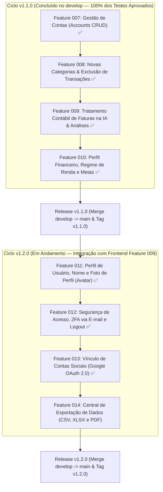
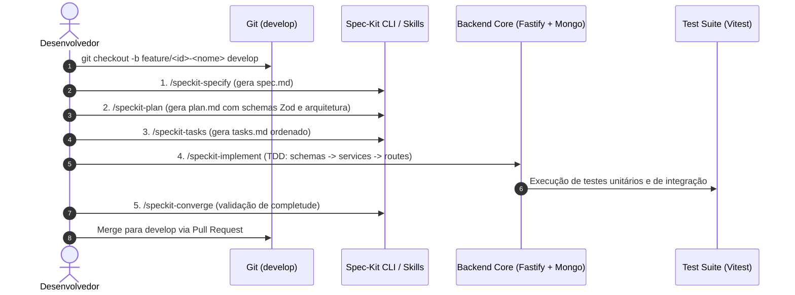

# 🗺️ Roadmap de Evolução — Backend (v1.1.0 & v1.2.0+)

Este documento detalha o ciclo de evolução do backend (`projeto-backend-dashboard`), estruturado conforme os princípios de **Schema-Driven Development (SDD)** e os fluxos do **Spec-Kit**, mantendo total paridade e sincronismo com o frontend (`projeto-frontend-dashboard`).

---

## 📌 Status Atual do Backend

| Versão | Status | Branches / Tags | Cobertura de Testes |
|---|---|---|---|
| **v1.0.0** | ✅ Concluída em Produção | Tag `v1.0.0` / Branch `main` | Testes unitários e de integração verdes |
| **v1.1.0** | ✅ Concluída no Código (Pronta para Release) | Branch `develop` (Aguardando merge para `main` e Tag `v1.1.0`) | 81 testes de especificações verdes (F007-F010) |
| **v1.2.0** | 🚧 Em Andamento (F011, F012 e F013 Concluídas) | Branches `feature/011-*` a `014-*` | 198 testes unitários e de integração verdes |

---

## 🎯 Visão Geral dos Ciclos v1.1.0 e v1.2.0

---

## 📦 Features Entregues (Ciclo v1.1.0)

### 🏦 Feature 007: Gestão de Contas Bancárias e Cartões (`specs/007-accounts-management`) ✅
- **Status**: Concluída (26/26 tarefas).
- **Endpoints**: `GET /api/accounts`, `POST /api/accounts`, `PATCH /api/accounts/:id`, `DELETE /api/accounts/:id`.
- Suporte a múltiplas contas, agregação de saldos e vinculação automática de transações e importações OFX/CSV.

### 🏷️ Feature 008: Novas Categorias Canônicas e Exclusão de Transações (`specs/008-categories-and-deletion`) ✅
- **Status**: Concluída (19/19 tarefas).
- **Endpoints**: `DELETE /api/transactions/:id`, `PATCH /api/transactions/:id`.
- Expansão para 11 categorias canônicas (`"Pagamento de Fatura"` e `"Investimentos"`), suporte no prompt do Gemini e remoção atômica com invalidação de cache de análise.

### 🧠 Feature 009: Tratamento Contábil Inteligente de Faturas (`specs/009-invoice-accounting-ai`) ✅
- **Status**: Concluída (17/17 tarefas).
- **Endpoints**: `GET /api/analysis/:month`.
- Segregação de faturas de cartão para eliminar duplicidade de despesas em `totalExpenses`, rastreamento do indicador `invoiceSettlements` e calibração contábil no Gemini.

### 👤 Feature 010: Perfil Financeiro, Regime de Renda e Metas (`specs/010-user-financial-profile`) ✅
- **Status**: Concluída (19/19 tarefas).
- **Endpoints**: `GET /api/user/profile`, `PUT /api/user/profile`.
- Cadastro voluntário de regime de trabalho (CLT, PJ, etc.), renda mensal declarada, metas financeiras prioritárias e calibração da reserva de emergência pela IA.

---

## 📦 Features Entregues no Ciclo v1.2.0

### 🖼️ Feature 011: Perfil de Usuário, Nome e Foto de Perfil (`specs/011-user-avatar-identity`) ✅
- **Status**: Concluída (12/12 tarefas).
- **Objetivo**: Permitir ao usuário atualizar seu nome de exibição, realizar upload de foto de perfil (avatar) com validação de formato e tamanho, e excluir a foto restaurando o fallback de iniciais.
- **Endpoints REST**:
  - `GET /api/user/profile`: Retorno completo dos dados cadastrais (`id`, `email`, `name`, `avatarUrl`, `hasAiKey`, `security`, `financialProfile`, `createdAt`).
  - `PATCH /api/user/profile`: Atualização de dados cadastrais (nome de 2 a 100 caracteres).
  - `POST /api/user/avatar`: Upload de avatar em `multipart/form-data` (máx. 5MB, jpeg/png/webp) com persistência em disco e URL servida.
  - `DELETE /api/user/avatar`: Remoção do avatar e retorno ao fallback `null`.

### 🛡️ Feature 012: Segurança de Acesso, 2FA via E-mail e Logout Seguro (`specs/012-two-factor-auth-session`) ✅
- **Status**: Concluída (23/23 tarefas).
- **Objetivo**: Proteger os dados financeiros com 2FA via OTP (6 dígitos) enviado por e-mail, desafio de interceptação no login e gerenciamento de sessões com revogação imediata (logout).
- **Endpoints REST**:
  - `POST /api/auth/login`: Interceptação para emissão de desafio `{ requires2FA: true, challengeId }` quando 2FA estiver ativo.
  - `POST /api/auth/2fa/verify`: Validação do OTP de 6 dígitos e emissão do JWT com claim de `sessionId`.
  - `POST /api/auth/2fa/enable`: Disparo do desafio para ativação de 2FA.
  - `POST /api/auth/2fa/confirm-enable`: Validação do código e ativação definitiva.
  - `POST /api/auth/2fa/disable`: Desativação de 2FA confirmada por senha local.
  - `POST /api/auth/2fa/resend`: Reenvio de OTP com respeito ao cooldown de 60s.
  - `POST /api/auth/logout`: Revogação da sessão ativa ou de todas as sessões do usuário (`allDevices`).

### 🔗 Feature 013: Vínculo de Contas Sociais — Google OAuth 2.0 (`specs/013-google-auth-linking`) ✅
- **Status**: Concluída (22/22 tarefas).
- **Objetivo**: Permitir que usuários vinculem ou desvinculem sua conta Google ao perfil existente, prevenindo desvinculação acidental caso o Google seja o único método de autenticação da conta, além de autenticação social com suporte a 2FA.
- **Endpoints REST**:
  - `POST /api/auth/google/link`: Validação do idToken do Google e vinculação de `googleId` e `googleEmail` ao perfil do usuário autenticado.
  - `DELETE /api/auth/google/unlink`: Desvinculação da conta Google com regra de guarda (rejeita com `400 Bad Request` se não houver senha local).
  - `POST /api/auth/google`: Login social via Google com emissão de sessão JWT e interceptação de 2FA.
  - `GET /api/user/profile`: Retorno dos metadados de vínculo social no subobjeto `security` (`googleLinked`, `googleEmail`, `googleLinkedAt`).

---

## 🚀 Features Planejadas (Ciclo v1.2.0 — Integração Frontend Feature 009)

As features abaixo espelham as necessidades e contratos formalizados no frontend (`specs/009-profile-security-export`), garantindo suporte integral a gerenciamento de identidade, segurança de sessão e central de relatórios financeiros.

---

### 📊 Feature 014: Central de Exportação de Dados Financeiros (`specs/014-financial-data-export`)
**Objetivo**: Fornecer endpoint unificado de exportação e download de extratos e relatórios financeiros em formatos CSV, XLSX e PDF com formatação localizada (BRL, datas em PT-BR) e filtros contextuais.

- **Contrato de Requisição & Query Parameters**:
  - `GET /api/transactions/export`:
    - `format`: `"csv" | "xlsx" | "pdf"` (obrigatório).
    - `month`: Formato `YYYY-MM` (opcional).
    - `startDate`: Formato `YYYY-MM-DD` (opcional).
    - `endDate`: Formato `YYYY-MM-DD` (opcional).
    - `accountId`: ID da conta bancária (opcional).
    - `category`: Categoria canônica (opcional).
- **Formatos Gerados**:
  - **CSV**: Codificação UTF-8 com BOM (`\uFEFF`) para compatibilidade nativa com Microsoft Excel no Brasil (delimitador `;` e vírgula decimal).
  - **XLSX**: Planilha estruturada via `exceljs` com cabeçalhos destacados, tipos numéricos formatados em moeda (`R$ #,##0.00`) e largura automática de colunas.
  - **PDF**: Relatório diagramado via `pdfkit` contendo cabeçalho institucional, sumário de KPIs (Receitas, Despesas, Saldo Líquido) e tabela de transações.
- **Etapas Spec-Kit**:
  1. `specify` -> 2. `plan` -> 3. `tasks` -> 4. `implement` -> 5. `converge`.

---

## 🔄 Fluxo de Trabalho por Feature (SDD & Spec-Kit)

Para cada feature acima, o fluxo estrito no repositório backend será:

---

## 🔮 Próximas Versões Futuras (Backlog v1.3.0+)

- [ ] **Importação Open Finance / Pluggy em Produção**: Conexão bancária direta automática via webhooks.
- [ ] **Regras Customizadas de Categorização**: Mecanismo de regras com prioridade e condições regex/substring.
- [ ] **Transações Recorrentes e Orçamentos (Budgets)**: Metas de teto orçamentário por categoria e alertas pró-ativos.
- [ ] **Notificações Push / Webhooks**: Avisos de vencimento de faturas e anomalias de consumo detectadas por IA.
