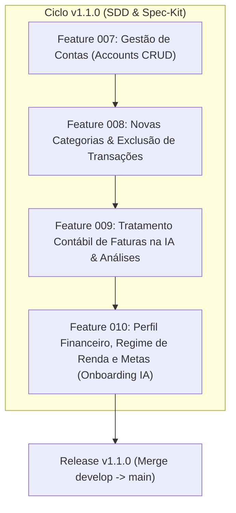
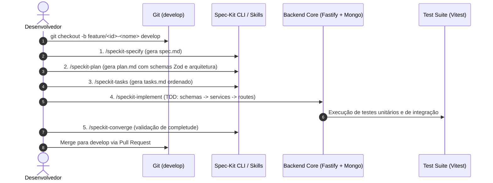

# 🗺️ Roadmap de Evolução — Backend (v1.1.0+)

Este documento detalha o ciclo de evolução do backend (`projeto-backend-dashboard-sdd`), estruturado conforme os princípios de **Schema-Driven Development (SDD)** e os fluxos do **Spec-Kit**.

---

## 🎯 Visão Geral da Versão 1.1.0

A versão 1.1.0 introduz o suporte nativo a **Múltiplas Contas Bancárias e Cartões**, **Exclusão de Transações**, **Novas Categorias Financeiras**, **Tratamento Contábil Inteligente de Faturas** e **Perfil Financeiro do Usuário (Onboarding Contextual para IA)**.



---

## 📋 Features Planejadas (Ciclo v1.1.0)

### 🏦 Feature 007: Gestão de Contas Bancárias e Cartões (`specs/007-accounts-management`)
**Objetivo**: Permitir ao usuário criar, renomear, listar e excluir contas financeiras (corrente, poupança, cartão de crédito, investimentos), associando transações e importações a contas específicas.

- **Contrato de Domínio & Modelagem**:
  - Modelo `Account` no MongoDB:
    ```typescript
    interface IAccount {
      _id: Types.ObjectId;
      userId: Types.ObjectId;
      name: string; // Ex: "Nubank Principal", "Itaú Corrente"
      type: 'CHECKING' | 'CREDIT_CARD' | 'INVESTMENT' | 'CASH' | 'OTHER';
      institution?: string; // Código/Nome do banco (ex: "260 - Nu Pagamentos")
      color?: string; // Hexadecimal para UI
      createdAt: Date;
      updatedAt: Date;
    }
    ```
  - Migração/Compatibilidade: Transações sem `accountId` associadas a uma conta padrão ("Conta Principal").
  - Atualização do `ITransaction` para incluir `accountId?: Types.ObjectId`.
- **Endpoints REST**:
  - `GET /api/accounts`: Listar contas do usuário com resumo de saldo e contagem de transações.
  - `POST /api/accounts`: Criar nova conta manual.
  - `PATCH /api/accounts/:id`: Renomear ou alterar propriedades da conta.
  - `DELETE /api/accounts/:id`: Excluir conta com política segura (opção de cascata para transações ou bloqueio se houver transações ativas).
- **Importação OFX / CSV**:
  - Parâmetro `accountId` obrigatório ou opcional (auto-detectar/criar conta a partir de tags OFX `<BANKID>` e `<ACCTID>`).
- **Etapas Spec-Kit**:
  1. `specify`: Definição de requisitos e casos de erro (404, 409 conflito de nome, 400 conta não pertence ao usuário).
  2. `plan`: Definição de schemas Zod, repositórios e serviços (`AccountService`).
  3. `tasks`: Lista de tarefas com TDD (testes de unidade e integração).
  4. `implement`: Execução e validação com 100% dos testes verdes.
  5. `converge`: Auditoria de conformidade.

---

### 🏷️ Feature 008: Novas Categorias Canônicas e Exclusão de Transações (`specs/008-categories-and-deletion`)
**Objetivo**: Expandir as categorias canônicas para suportar faturas e investimentos, e permitir a exclusão pontual de lançamentos.

- **Novas Categorias Canônicas**:
  - Adição de `"Pagamento de Fatura"` e `"Investimentos"` ao `CANONICAL_CATEGORIES` em `src/config/constants.ts`.
  - Atualização dos prompts de categorização da IA Gemini para reconhecer e classificar automaticamente liquidações de fatura e aportes de investimento.
- **Exclusão de Transações**:
  - Endpoint `DELETE /api/transactions/:id`:
    - Validação de propriedade (`userId === transaction.userId`).
    - Remoção atômica e invalidação do cache de análises (`AnalysisService.invalidate(userId)`).
    - Status HTTP `204 No Content` ou `200 OK` com payload de confirmação.
- **Etapas Spec-Kit**:
  1. `specify` -> 2. `plan` -> 3. `tasks` -> 4. `implement` -> 5. `converge`.

---

### 🧠 Feature 009: Tratamento Contábil Inteligente (Fatura de Cartão na IA e Métricas)
**Objetivo**: Evitar duplicidade de despesas nos relatórios quando o usuário importa tanto o extrato da conta corrente quanto a fatura do cartão.

- **Regra Contábil**:
  - Transações na categoria `"Pagamento de Fatura"` não somam como despesa primária nos gráficos de distribuição de gastos (pois os itens individuais da fatura já foram somados como alimentação, transporte, etc.).
  - A IA Assistente deve reconhecer pagamentos de fatura como transferências de liquidação entre contas.
- **Etapas Spec-Kit**:
  1. `specify` -> 2. `plan` -> 3. `tasks` -> 4. `implement` -> 5. `converge`.

---

### 👤 Feature 010: Perfil Financeiro, Regime de Renda e Metas do Usuário (`specs/010-user-financial-profile`)
**Objetivo**: Permitir ao usuário cadastrar voluntariamente informações contextuais sobre seu regime de trabalho, renda mensal estimada e objetivos financeiros prioritários, alimentando a IA Gemini com contexto de alta precisão para geração de relatórios personalizados e planejamento estratégico de reservas.

- **Contrato de Domínio & Modelagem**:
  - Modelo `User` no MongoDB estendido com subdocumento opcional `financialProfile`:
    ```typescript
    interface IFinancialProfile {
      incomeType?: 'CLT' | 'PJ_AUTONOMO' | 'PUBLIC_SERVANT' | 'ENTREPRENEUR' | 'STUDENT' | 'RETIRED' | 'OTHER';
      declaredMonthlyIncome?: number; // Valor numérico decimal opcional
      goals?: Array<'RESERVA_EMERGENCIA' | 'QUITAR_DIVIDAS' | 'COMPRAR_IMOVEL' | 'INVESTIR_LONGO_PRAZO' | 'CONTROLE_GASTOS'>;
      riskProfile?: 'CONSERVATIVE' | 'MODERATE' | 'AGGRESSIVE';
      updatedAt?: Date;
    }
    ```
- **Endpoints REST**:
  - `GET /api/user/profile`: Retornar perfil cadastral e financeiro do usuário autenticado.
  - `PUT /api/user/profile`: Atualizar ou preencher regime de renda, valor declarado e metas financeiras.
- **Integração com IA (Gemini)**:
  - Injeção de contexto no prompt de análise mensal (`AnalysisService`) e no assistente de chat (`ChatService`), calibrando o cálculo ideal da reserva de emergência (ex: 3 a 6 meses para CLT vs. 6 a 12 meses para PJ) e priorizando metas do usuário.
- **Conformidade LGPD**:
  - Preenchimento 100% facultativo (voluntário) pelo usuário com finalidade estrita de PFM (Personal Financial Management), sem fins de scoring punitivo ou compartilhamento externo.
- **Etapas Spec-Kit**:
  1. `specify` -> 2. `plan` -> 3. `tasks` -> 4. `implement` -> 5. `converge`.

---

## 🔄 Fluxo de Trabalho por Feature (SDD & Spec-Kit)

Para cada feature acima, o fluxo estrito no repositório backend será:



---

## 🚀 Próximas Versões Futuras (Backlog v1.2.0+)

- [ ] **Importação Open Finance / Pluggy em Produção**: Conexão bancária direta automática.
- [ ] **Regras Customizadas de Categorização**: Regras do tipo "se descrição contém X, categorizar como Y".
- [ ] **Transações Recorrentes e Orçamentos (Budgets)**: Limites de gastos por categoria e alertas automáticos.
- [ ] **Exportação de Relatórios**: Exportação em CSV, PDF e XLSX formatados.
