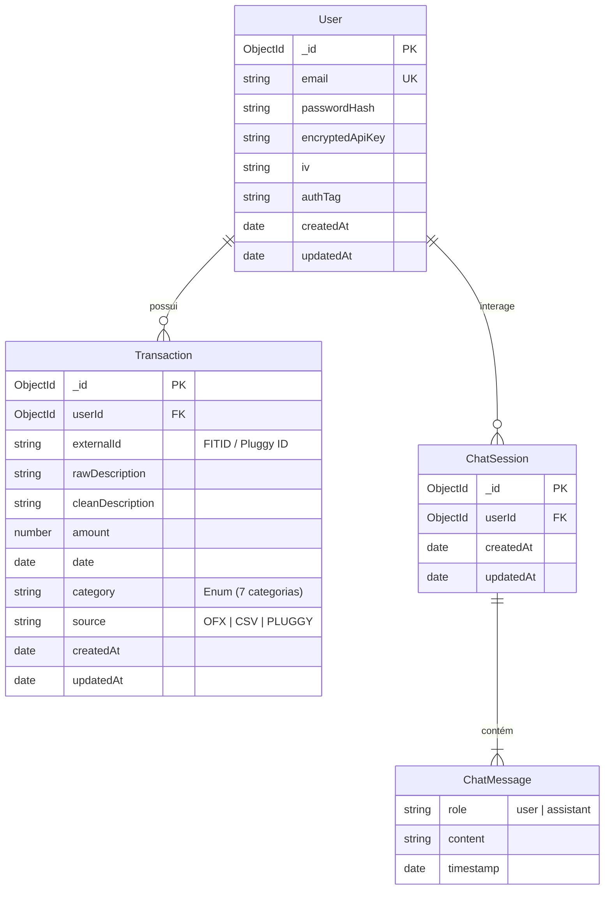

# Data Model: API REST do Backend Financeiro

**Feature**: `001-financial-backend-api`  
**Date**: 2026-10-13  
**Status**: Concluído (Fase 1)

Este documento descreve as entidades, esquemas Mongoose, regras de validação Zod e índices de banco de dados para o MongoDB.

---

## 1. Entidade `User` (Coleção: `users`)

Representa o usuário cadastrado no sistema e armazena os metadados de autenticação e credencial BYOK criptografada.

### Esquema e Atributos

| Campo | Tipo Mongoose | Validação Zod | Descrição |
|---|---|---|---|
| `_id` | `Schema.Types.ObjectId` | `z.string()` | Identificador único do documento |
| `email` | `String` | `z.string().email().toLowerCase()` | E-mail do usuário (único, indexado) |
| `passwordHash` | `String` | `z.string().min(60)` | Hash seguro da senha do usuário |
| `encryptedApiKey` | `String` | `z.string().optional()` | Texto cifrado da API Key do Gemini (Hex) |
| `iv` | `String` | `z.string().length(24).optional()` | Vetor de inicialização de 12 bytes em Hex |
| `authTag` | `String` | `z.string().length(32).optional()` | Tag de autenticação GCM de 16 bytes em Hex |
| `createdAt` | `Date` | `z.date()` | Data de criação do registro |
| `updatedAt` | `Date` | `z.date()` | Data de última atualização |

### Índices
- `{ email: 1 }` com `{ unique: true }`

### Regras de Negócio e Ciclo de Vida
- `encryptedApiKey`, `iv` e `authTag` são nulos no momento do cadastro e preenchidos somente após a validação ativa da chave BYOK via `PUT /api/user/ai-key`.
- A chave pura **NUNCA** é persistida ou exposta no objeto retornado por queries ou respostas da API.

---

## 2. Entidade `Transaction` (Coleção: `transactions`)

Representa um lançamento financeiro padronizado, unificando dados originados de arquivos OFX, CSV ou Open Finance (Pluggy).

### Esquema e Atributos

| Campo | Tipo Mongoose | Validação Zod | Descrição |
|---|---|---|---|
| `_id` | `Schema.Types.ObjectId` | `z.string()` | Identificador único da transação |
| `userId` | `Schema.Types.ObjectId` | `z.string()` | Referência ao usuário proprietário (`users._id`) |
| `externalId` | `String` | `z.string().min(1)` | Identificador externo (FITID no OFX ou ID na Pluggy) |
| `rawDescription` | `String` | `z.string()` | Descrição textual crua do lançamento |
| `cleanDescription`| `String` | `z.string()` | Descrição sanitizada e expurgada de PII (LGPD) |
| `amount` | `Number` | `z.number()` | Valor monetário (negativo = despesa, positivo = receita) |
| `date` | `Date` | `z.date()` | Data da efetivação da transação |
| `category` | `String` | `CategoryEnum` | Categoria do catálogo canônico (Default: `'Outros'`) |
| `source` | `String` | `z.enum(['OFX', 'CSV', 'PLUGGY'])` | Canal de ingestão de origem |
| `createdAt` | `Date` | `z.date()` | Data de ingestão no banco |
| `updatedAt` | `Date` | `z.date()` | Data da última atualização |

### Catálogo Canônico de Categorias (`CategoryEnum`)
```typescript
export const TransactionCategory = z.enum([
  'Alimentação',
  'Transporte',
  'Moradia',
  'Saúde',
  'Lazer',
  'Educação',
  'Outros'
]);
export type TransactionCategory = z.infer<typeof TransactionCategory>;
```

### Índices
- **Índice Composto Único para Idempotência**: `{ userId: 1, externalId: 1 }` com `{ unique: true }`. Garante que reenvios de extrato pelo mesmo usuário ignorem registros duplicados.
- **Índice para Consultas Temporais**: `{ userId: 1, date: -1 }`.
- **Índice para Agregações por Categoria**: `{ userId: 1, category: 1 }`.

---

## 3. Entidade `ChatSession` (Coleção: `chat_sessions`)

Representa uma sessão de interação entre o usuário e a consultoria financeira com IA.

### Esquema e Atributos

| Campo | Tipo Mongoose | Validação Zod | Descrição |
|---|---|---|---|
| `_id` | `Schema.Types.ObjectId` | `z.string()` | Identificador da sessão |
| `userId` | `Schema.Types.ObjectId` | `z.string()` | Referência ao usuário (`users._id`) |
| `messages` | `Array<ChatMessageSubdoc>` | `z.array(ChatMessageSchema)` | Histórico cronológico das mensagens da sessão |
| `createdAt` | `Date` | `z.date()` | Data de abertura da sessão |
| `updatedAt` | `Date` | `z.date()` | Timestamp da última interação |

### Subdocumento `ChatMessage`

| Campo | Tipo Mongoose | Validação Zod | Descrição |
|---|---|---|---|
| `role` | `String` | `z.enum(['user', 'assistant'])` | Papel do emissor da mensagem |
| `content` | `String` | `z.string().min(1)` | Conteúdo textual da mensagem |
| `timestamp` | `Date` | `z.date()` | Horário em que a mensagem foi enviada/gerada |

### Índices
- `{ userId: 1, updatedAt: -1 }`: Otimiza a recuperação da sessão mais recente do usuário.

---

## 4. Diagrama de Relacionamento (Mermaid)


