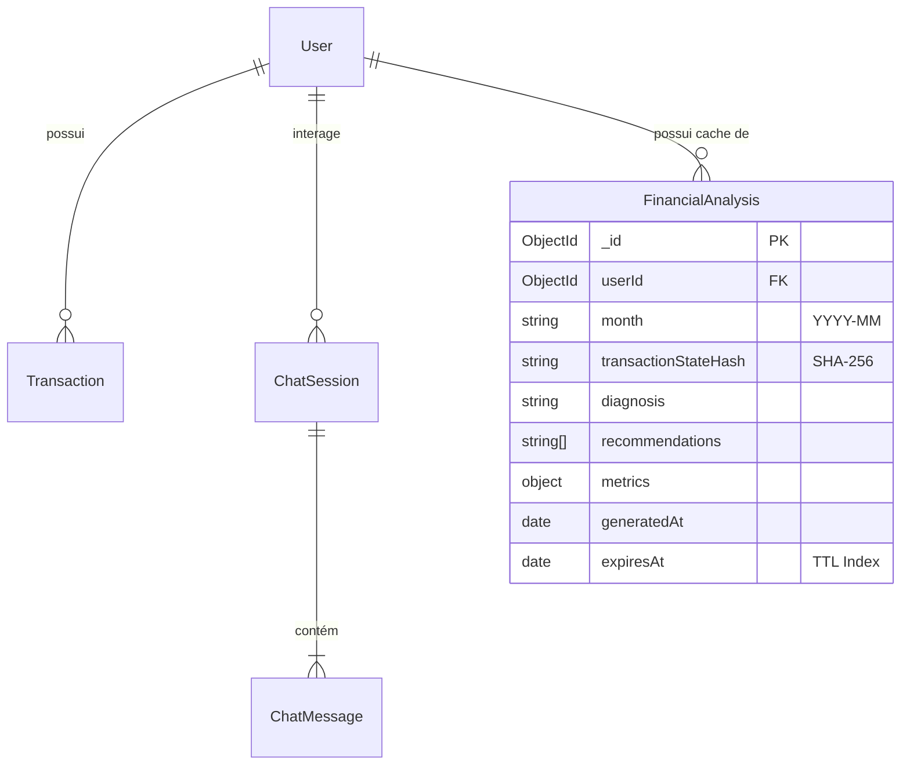

# Data Model: Cache de Análises Financeiras & Configuração de Seed

**Feature**: `002-seed-cache-analysis`  
**Date**: 2026-10-13  
**Status**: Concluído (Fase 1)

---

## 1. Nova Entidade: `FinancialAnalysis` (Coleção: `financial_analyses`)

Armazena os diagnósticos orçamentários mensais gerados por IA com controle de TTL e hash de estado de transações.

### Esquema e Atributos Mongoose & Zod

| Campo | Tipo Mongoose | Validação Zod | Descrição |
|---|---|---|---|
| `_id` | `Schema.Types.ObjectId` | `z.string()` | Identificador único da análise |
| `userId` | `Schema.Types.ObjectId` | `z.string()` | Referência ao usuário (`users._id`) |
| `month` | `String` | `z.string().regex(/^\d{4}-\d{2}$/)` | Mês de competência (formato YYYY-MM) |
| `transactionStateHash`| `String` | `z.string()` | Hash SHA-256 do estado das transações no momento da geração |
| `diagnosis` | `String` | `z.string().min(1)` | Diagnóstico orçamentário detalhado gerado pela IA |
| `recommendations` | `[String]` | `z.array(z.string())` | Lista de recomendações práticas de corte/otimização |
| `metrics` | `Subdocumento` | `FinancialMetricsSchema` | Métricas numéricas consolidadas |
| `metrics.totalIncome` | `Number` | `z.number()` | Total de entradas do mês |
| `metrics.totalExpenses`| `Number` | `z.number()` | Total de saídas do mês |
| `metrics.netBalance` | `Number` | `z.number()` | Saldo líquido |
| `metrics.savingsRate` | `Number` | `z.number()` | Percentual de economia/poupança sobre receitas |
| `metrics.topCategories`| `Array` | `z.array(CategorySummary)` | Distribuição dos maiores gastos |
| `generatedAt` | `Date` | `z.date()` | Momento da inferência |
| `expiresAt` | `Date` | `z.date()` | Momento da expiração temporal do cache (TTL de 24h) |

### Índices de Banco de Dados

1. **Índice Composto Único por Usuário e Mês**:
   ```javascript
   { userId: 1, month: 1 }, { unique: true }
   ```
   Garante no máximo 1 registro ativo de análise por mês para cada usuário.

2. **Índice TTL Nativo do MongoDB**:
   ```javascript
   { expiresAt: 1 }, { expireAfterSeconds: 0 }
   ```
   Permite que o próprio motor do MongoDB remova automaticamente análises vencidas sem sobrecarga de aplicação.

---

## 2. Diagrama de Entidade-Relacionamento Atualizado (Mermaid)


