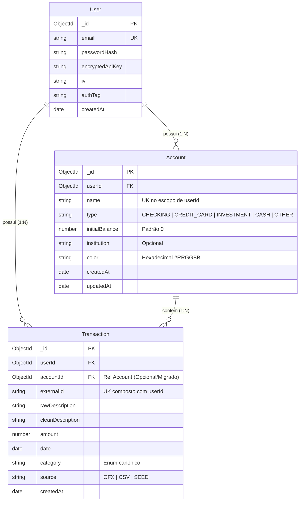
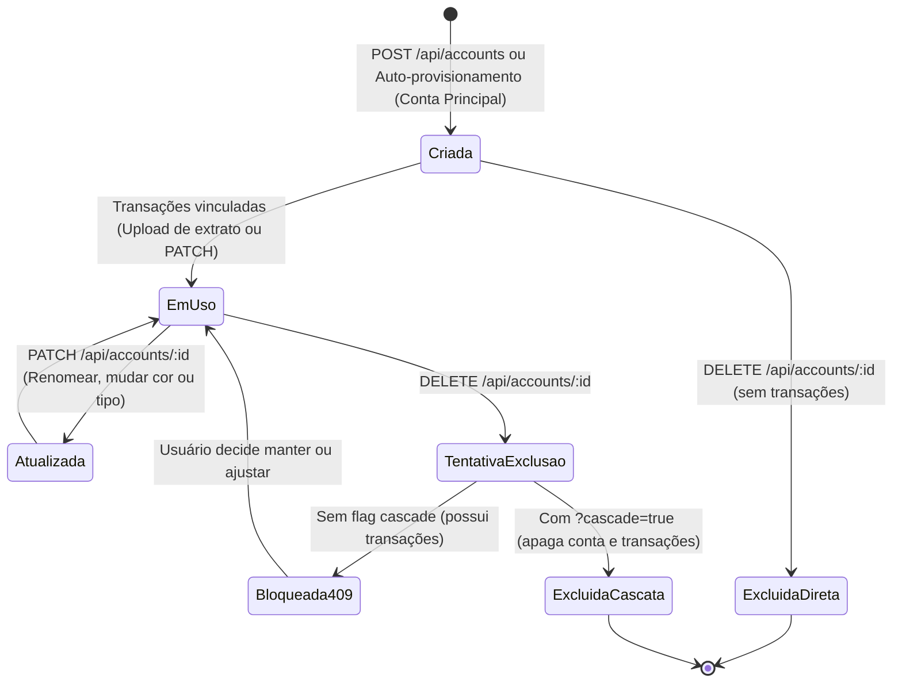

# Data Model: Gestão de Contas Bancárias e Cartões

**Feature**: `007-accounts-management`  
**Date**: 2026-10-19  
**Status**: Concluído (Phase 1)

---

## 1. Entidades do Domínio

### 1.1 Entidade `Account` (Coleção: `accounts`)

Representa uma conta financeira cadastrada pelo usuário (conta corrente, cartão de crédito, investimento, dinheiro ou outros).

```typescript
import mongoose, { Document, Schema, Types } from 'mongoose';
import { ACCOUNT_TYPES, AccountType } from '../config/constants.js';

export interface IAccount extends Document {
  _id: Types.ObjectId;
  userId: Types.ObjectId;
  name: string;
  type: AccountType;
  initialBalance: number;
  institution?: string;
  color?: string;
  createdAt: Date;
  updatedAt: Date;
}
```

#### Regras de Validação e Atributos:
- `_id`: Gerado automaticamente pelo MongoDB.
- `userId`: Obrigatório. Referência ao modelo `User`. Identificador do proprietário (multi-tenancy).
- `name`: Obrigatório. String com tamanho entre 1 e 50 caracteres (trimmed). Único por usuário.
- `type`: Obrigatório. Enum com valores aceitos: `'CHECKING' | 'CREDIT_CARD' | 'INVESTMENT' | 'CASH' | 'OTHER'`.
- `initialBalance`: Opcional. Número decimal (positivo, negativo ou zero). Padrão: `0`.
- `institution`: Opcional. String com até 100 caracteres representando a instituição financeira (ex: "Nubank", "Banco Itaú").
- `color`: Opcional. String hexadecimal válida (ex: `#2563EB`, formato regex `/^#[0-9A-Fa-f]{6}$/`). Padrão do sistema: `#64748B`.
- `createdAt` / `updatedAt`: Gerados automaticamente via `timestamps: true`.

#### Índices do Mongoose:
```typescript
// Unicidade de nome por usuário
AccountSchema.index({ userId: 1, name: 1 }, { unique: true });

// Otimização de listagem de contas por usuário
AccountSchema.index({ userId: 1, createdAt: 1 });
```

---

### 1.2 Atualização da Entidade `Transaction` (Coleção: `transactions`)

A entidade `Transaction` ganha a referência relacional lógica para a conta à qual pertence:

```typescript
export interface ITransaction extends Document {
  _id: Types.ObjectId;
  userId: Types.ObjectId;
  accountId?: Types.ObjectId; // NOVO: Vínculo com a conta bancária/cartão
  externalId: string;
  rawDescription: string;
  cleanDescription: string;
  amount: number;
  date: Date;
  category: Category;
  source: TransactionSource;
  createdAt: Date;
  updatedAt: Date;
}
```

#### Definição no Schema Mongoose:
```typescript
accountId: {
  type: Schema.Types.ObjectId,
  ref: 'Account',
  required: false,
  index: true,
}
```

#### Novos Índices Otimizados:
```typescript
// Índice para agregação ultra-rápida de saldos e contagens por conta
TransactionSchema.index({ userId: 1, accountId: 1 });
```

---

## 2. Diagrama de Relacionamento de Entidades (ERD)



---

## 3. Estados e Ciclo de Vida da Conta



---

## 4. DTOs e Schemas Zod de Validação

### 4.1 Schemas de Criação e Atualização de Contas
```typescript
import { z } from 'zod';
import { ACCOUNT_TYPES } from '../config/constants.js';

export const AccountTypeSchema = z.enum(ACCOUNT_TYPES);

export const CreateAccountBodySchema = z.object({
  name: z.string().trim().min(1, 'Nome é obrigatório').max(50, 'Nome deve ter no máximo 50 caracteres'),
  type: AccountTypeSchema,
  initialBalance: z.number().optional().default(0),
  institution: z.string().trim().max(100).optional(),
  color: z.string().regex(/^#[0-9A-Fa-f]{6}$/, 'Cor deve estar no formato hexadecimal (#RRGGBB)').optional(),
});

export const UpdateAccountBodySchema = z.object({
  name: z.string().trim().min(1).max(50).optional(),
  type: AccountTypeSchema.optional(),
  initialBalance: z.number().optional(),
  institution: z.string().trim().max(100).optional(),
  color: z.string().regex(/^#[0-9A-Fa-f]{6}$/, 'Cor deve estar no formato hexadecimal (#RRGGBB)').optional(),
}).refine(data => Object.keys(data).length > 0, {
  message: 'Pelo menos um campo deve ser fornecido para atualização.',
});

export const AccountIdParamSchema = z.object({
  id: z.string().regex(/^[0-9a-fA-F]{24}$/, 'ID de conta deve ser um ObjectId hexadecimal válido de 24 caracteres'),
});

export const DeleteAccountQuerySchema = z.object({
  cascade: z.enum(['true', 'false']).optional().default('false'),
});

export const AccountResponseItemSchema = z.object({
  id: z.string(),
  userId: z.string(),
  name: z.string(),
  type: AccountTypeSchema,
  initialBalance: z.number(),
  institution: z.string().optional(),
  color: z.string().optional(),
  balance: z.number(),
  transactionCount: z.number(),
  createdAt: z.string(),
  updatedAt: z.string(),
});

export const ListAccountsResponseSchema = z.object({
  accounts: z.array(AccountResponseItemSchema),
  totalAccounts: z.number(),
  netWorth: z.number(),
});
```
