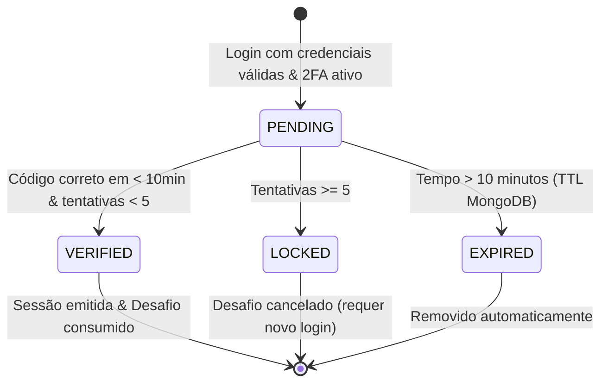
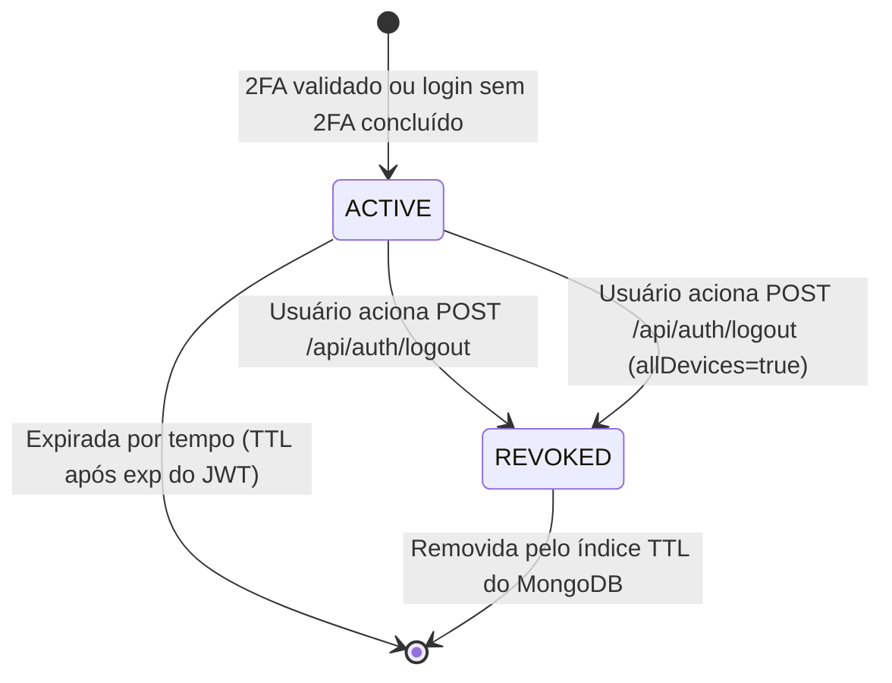

# Data Model: Autenticação em Dois Fatores (2FA) e Revogação de Sessão

## Visão Geral

Este documento define o modelo de dados para suportar a verificação em duas etapas via e-mail e o gerenciamento de sessões com capacidade de revogação imediata (logout seguro), operando sobre o MongoDB com tipagem estrita via Mongoose e esquemas Zod.

---

## 1. Entidades

### 1.1 Atualização da Entidade `User` (Coleção `users`)

Extensão do esquema existente para gerenciar o estado da autenticação em dois fatores.

```typescript
export interface IUser extends Document {
  _id: mongoose.Types.ObjectId;
  email: string;
  passwordHash: string;
  name?: string;
  avatarUrl?: string | null;
  encryptedApiKey?: string | null;
  iv?: string | null;
  authTag?: string | null;
  financialProfile?: IFinancialProfile;
  
  // Novos campos para 2FA
  isTwoFactorEnabled: boolean;       // Padrão: false
  twoFactorConfirmedAt?: Date | null; // Data da ativação confirmada
  
  createdAt: Date;
  updatedAt: Date;
  hasAiKey(): boolean;
}
```

- **Campos adicionados**:
  - `isTwoFactorEnabled`: `Boolean`, `default: false`, `required: true`.
  - `twoFactorConfirmedAt`: `Date`, `required: false`.

---

### 1.2 Entidade `TwoFactorChallenge` (Coleção `two_factor_challenges`)

Armazena os desafios temporários de verificação (login ou ativação de 2FA) com expiração automática via índice TTL.

```typescript
export type TwoFactorChallengeType = 'LOGIN' | 'ENABLE';
export type TwoFactorChallengeStatus = 'PENDING' | 'VERIFIED' | 'EXPIRED' | 'LOCKED';

export interface ITwoFactorChallenge extends Document {
  _id: mongoose.Types.ObjectId;
  userId: mongoose.Types.ObjectId;
  type: TwoFactorChallengeType;
  otpHash: string;                  // Hash SHA-256 do código de 6 dígitos (nunca em texto plano)
  attempts: number;                 // Contador de tentativas incorretas (máx: 5)
  maxAttempts: number;              // Limite tolerado: 5
  status: TwoFactorChallengeStatus; // Padrão: 'PENDING'
  lastSentAt: Date;                 // Para controle do cooldown de 60s
  expiresAt: Date;                  // Data de expiração (10 minutos após emissão)
  verifiedAt?: Date | null;
  createdAt: Date;
  updatedAt: Date;
}
```

- **Regras de Negócio e Validações**:
  - `otpHash`: String com 64 caracteres hexadecimais (SHA-256 do código de 6 dígitos numéricos).
  - `attempts`: Inteiro `>= 0`. Ao atingir 5, o status transita para `'LOCKED'`.
  - `status`: Transita de `PENDING` para `VERIFIED` (sucesso), `LOCKED` (excesso de erros) ou `EXPIRED` (tempo esgotado).
  - `lastSentAt`: Utilizado para validação `Date.now() - lastSentAt >= 60_000` em requisições de reenvio.

- **Índices**:
  - `expiresAt`: Índice TTL com `expireAfterSeconds: 0` (o MongoDB deleta automaticamente documentos cujo `expiresAt <= now`).
  - `{ userId: 1, status: 1 }`: Índice composto para busca rápida de desafios abertos por usuário.

---

### 1.3 Entidade `Session` (Coleção `sessions`)

Registra todas as sessões emitidas após login bem-sucedido, viabilizando rastreabilidade e revogação sob demanda (logout pontual ou global).

```typescript
export interface ISession extends Document {
  _id: string;                      // sessionId (UUID v4 gerado no backend)
  userId: mongoose.Types.ObjectId;
  isRevoked: boolean;               // Padrão: false
  revokedAt?: Date | null;
  userAgent?: string | null;        // Metadados do navegador/dispositivo
  ip?: string | null;               // Endereço IP de origem
  createdAt: Date;
  expiresAt: Date;                  // Alinhado ao prazo de expiração do JWT (ex: 7 dias)
}
```

- **Regras de Negócio e Validações**:
  - `_id`: String UUID v4. Presente na claim `sessionId` do JWT gerado.
  - `isRevoked`: Booleano indicando se o acesso foi cancelado por logout explícito.
  - `expiresAt`: Data limite da sessão; garante que o MongoDB remova registros legados via TTL.

- **Índices**:
  - `_id`: Chave primária (busca em tempo $O(1)$ a cada requisição autenticada).
  - `expiresAt`: Índice TTL com `expireAfterSeconds: 0`.
  - `{ userId: 1, isRevoked: 1 }`: Índice para cancelamento rápido de todas as sessões ativas do usuário (`logout-all`).

---

## 2. Diagrama de Transição de Estados

### Ciclo de Vida do Desafio 2FA (TwoFactorChallenge)



### Ciclo de Vida da Sessão de Acesso (Session)


