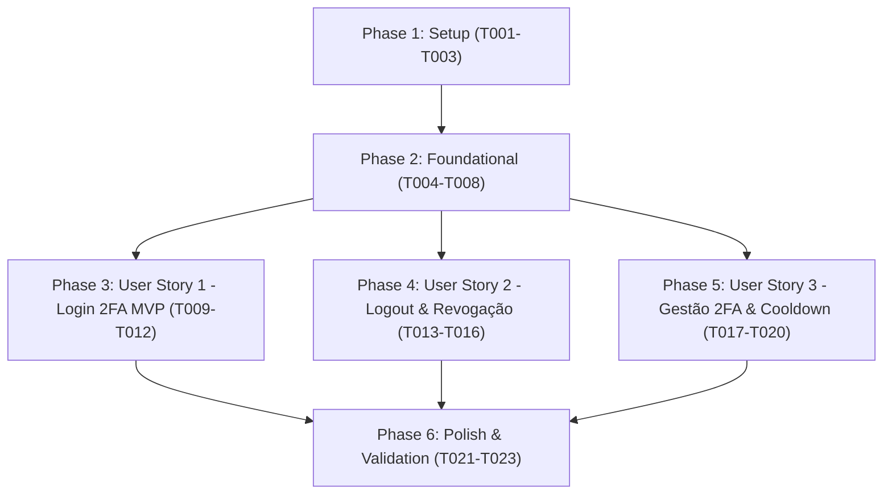

# Tasks: Autenticação em Dois Fatores (2FA via E-mail) e Revogação de Sessão

**Input**: Design documents from `specs/012-two-factor-auth-session/` (`spec.md`, `plan.md`, `data-model.md`, `contracts/auth-2fa.contract.md`, `research.md`, `quickstart.md`)

**Prerequisites**: `plan.md` (concluído), `spec.md` (concluído), `data-model.md` (concluído), `contracts/auth-2fa.contract.md` (concluído)

**Tests**: Testes automatizados incluídos para garantir cobertura de integração e isolamento de cada jornada do usuário.

**Organization**: Tarefas agrupadas por histórias de usuário para entrega incremental e teste independente de cada jornada.

## Format: `[TaskID] [P?] [Story?] Description with file path`

- **[P]**: Tarefa executável em paralelo (arquivos distintos, sem dependência de tarefas incompletas)
- **[Story]**: História de usuário à qual a tarefa pertence (`[US1]`, `[US2]`, `[US3]`)
- Arquivos especificados com caminhos exatos

---

## Estratégia de Branches por Tarefa / História (Git Branch Strategy)

Conforme orientação do usuário, o ciclo de desenvolvimento adota branches dedicadas para cada incremento:

- **Branch Base da Feature**: `012-two-factor-auth-session`
- **Branches de Setup / Foundation**: `task/012-setup-[id]-[slug]` (ex: `task/012-setup-t001-config`)
- **Branches por Tarefa de História**: `task/012-[us1|us2|us3]-[id]-[slug]` (ex: `task/012-us1-t009-login-schemas`)
- **Branches Integradas de História**:
  - **US1 (MVP)**: `feature/012-2fa-us1-login-interception`
  - **US2**: `feature/012-2fa-us2-session-logout`
  - **US3**: `feature/012-2fa-us3-management-resend`

---

## Phase 1: Setup (Shared Infrastructure)

**Purpose**: Configuração de constantes, tipagens globais e serviço base de mensageria de e-mail.

- [X] T001 Configure environment variables and constants for 2FA and Session management in `src/config/constants.ts` (OTP expiration: 10 min, max attempts: 5, resend cooldown: 60s, session TTL: 7 days)
- [X] T002 Update Fastify JWT TypeScript interface with `sessionId` claim in `src/@types/fastify.d.ts`
- [X] T003 [P] Create `EmailService` with modular local development logging and SMTP transport adapter in `src/services/email.service.ts`

---

## Phase 2: Foundational (Blocking Prerequisites)

**Purpose**: Estruturas de dados no MongoDB e camada de middleware de autenticação requeridas por todas as histórias.

**⚠️ CRITICAL**: Nenhuma história de usuário pode ser finalizada antes da conclusão desta fundação.

- [X] T004 Extend `User` schema and interface with `isTwoFactorEnabled: boolean` (default: false) and `twoFactorConfirmedAt?: Date | null` in `src/models/user.model.ts`
- [X] T005 [P] Create `TwoFactorChallenge` Mongoose model with `userId`, `type` ('LOGIN' | 'ENABLE'), `otpHash`, `attempts`, `status`, `lastSentAt`, and TTL index on `expiresAt` in `src/models/two-factor-challenge.model.ts`
- [X] T006 [P] Create `Session` Mongoose model with `_id` (UUID), `userId`, `isRevoked`, `revokedAt`, `userAgent`, `ip`, `createdAt`, and TTL index on `expiresAt` in `src/models/session.model.ts`
- [X] T007 Implement `SessionService` for session creation, validation, and active status check in `src/services/session.service.ts`
- [X] T008 Update `requireAuth` preHandler in `src/plugins/auth.plugin.ts` to inspect `sessionId` and reject revoked or missing sessions with HTTP 401

**Checkpoint**: Fundação pronta - a implementação das histórias de usuário pode prosseguir.

---

## Phase 3: User Story 1 - Interceptação no Login com Desafio 2FA via E-mail (Priority: P1) 🎯 MVP

**Goal**: Bloquear a emissão direta de JWT para usuários com 2FA ativo, gerar código OTP de 6 dígitos enviado por e-mail e autenticar o usuário após a confirmação válida do código.

**Independent Test**: Realizar login com usuário configurado com 2FA ativo, confirmar recepção de `{ requires2FA: true, challengeId }`, verificar entrega do código por e-mail e validar emissão do JWT e sessão via `POST /api/auth/2fa/verify`.

### Tests for User Story 1 ⚠️

- [X] T009 [P] [US1] Create integration test suite for 2FA login interception, challenge issuance, and OTP verification in `tests/integration/auth-2fa-login.test.ts`

### Implementation for User Story 1

- [X] T010 [P] [US1] Define Zod schemas for login 2FA response (`Login2FAResponseSchema`) and OTP verification (`Verify2FARequestSchema`) in `src/schemas/auth.schemas.ts`
- [X] T011 [US1] Implement 2FA challenge creation, OTP generation (`crypto.randomInt`), SHA-256 hashing, email dispatch, and timing-safe code verification in `src/services/auth.service.ts`
- [X] T012 [US1] Update `POST /api/auth/login` to intercept when 2FA is active and register `POST /api/auth/2fa/verify` endpoint in `src/routes/auth.routes.ts`

**Checkpoint**: História de Usuário 1 (MVP) completamente funcional e testável de forma independente.

---

## Phase 4: User Story 2 - Logout Seguro com Revogação Imediata de Sessão (Priority: P2)

**Goal**: Garantir que o encerramento de sessão (logout pontual ou em todos os dispositivos) invalide imediatamente o token no servidor, impedindo reapresentação de credenciais revogadas.

**Independent Test**: Autenticar o usuário, capturar credencial com `sessionId`, efetuar chamada em `POST /api/auth/logout`, e comprovar que qualquer requisição seguinte com o token revogado recebe HTTP 401.

### Tests for User Story 2 ⚠️

- [X] T013 [P] [US2] Create integration test suite for single session revocation and global logout in `tests/integration/auth-logout.test.ts`

### Implementation for User Story 2

- [X] T014 [P] [US2] Define Zod schema for logout request (`LogoutRequestSchema` with optional `allDevices: boolean`) in `src/schemas/auth.schemas.ts`
- [X] T015 [US2] Implement `revokeSession(sessionId)` and `revokeAllUserSessions(userId)` methods in `src/services/session.service.ts`
- [X] T016 [US2] Register `POST /api/auth/logout` endpoint protected by `requireAuth` in `src/routes/auth.routes.ts`

**Checkpoint**: Histórias de Usuário 1 e 2 plenamente funcionais e integradas.

---

## Phase 5: User Story 3 - Ativação, Desativação e Reenvio de Código OTP (Priority: P3)

**Goal**: Permitir aos usuários gerenciarem a proteção 2FA (ativação com validação prévia de e-mail e desativação confirmada por senha) e solicitar reenvio de OTP respeitando cooldown de 60 segundos.

**Independent Test**: Ativar 2FA em conta autenticada validando código de teste, testar bloqueio por taxa de reenvio rápido (HTTP 429) e desativar 2FA informando senha correta.

### Tests for User Story 3 ⚠️

- [X] T017 [P] [US3] Create integration test suite for 2FA enable/confirm, disable with password, and resend cooldown in `tests/integration/auth-2fa-management.test.ts`

### Implementation for User Story 3

- [X] T018 [P] [US3] Define Zod schemas for OTP resend (`Resend2FARequestSchema`) and 2FA deactivation (`Disable2FARequestSchema`) in `src/schemas/auth.schemas.ts`
- [X] T019 [US3] Implement `resendOtp`, `initiateEnable2FA`, `confirmEnable2FA`, and `disable2FA` in `src/services/auth.service.ts`
- [X] T020 [US3] Register endpoints `POST /api/auth/2fa/enable`, `POST /api/auth/2fa/confirm-enable`, `POST /api/auth/2fa/disable`, and `POST /api/auth/2fa/resend` in `src/routes/auth.routes.ts`

**Checkpoint**: Todas as três histórias de usuário implementadas e validadas.

---

## Phase 6: Polish & Cross-Cutting Concerns

**Purpose**: Documentação da API, conformidade com a Constituição e garantia de qualidade estática.

- [X] T021 [P] Update Swagger/OpenAPI documentation schemas and descriptions for all 2FA and logout routes in `src/routes/auth.routes.ts`
- [X] T022 Execute full test suite and TypeScript strict verification with zero errors (`npm test && npm run typecheck`)
- [X] T023 Run end-to-end quickstart validation scenarios from `specs/012-two-factor-auth-session/quickstart.md`

---

## Dependencies & Execution Order

### Phase Dependencies

- **Setup (Phase 1)**: Sem dependências prévias.
- **Foundational (Phase 2)**: Depende do Setup. **Bloqueia todas as histórias**.
- **User Story 1 (P1)**: Depende da Fundação. Define o MVP principal.
- **User Story 2 (P2)**: Depende da Fundação e da claim `sessionId` no plugin de autenticação.
- **User Story 3 (P3)**: Depende da Fundação e dos métodos de validação de desafio.
- **Polish (Phase 6)**: Executada após a conclusão das histórias desejadas.

---

## Parallel Opportunities

- **Setup**: `T002` e `T003` podem ser desenvolvidas em paralelo.
- **Foundational**: `T005` (`TwoFactorChallenge`) e `T006` (`Session`) são modelos completamente independentes.
- **Testes das Histórias**: `T009`, `T013` e `T017` podem ser criados paralelamente por desenvolvedores distintos.
- **Schemas Zod**: `T010`, `T014` e `T018` podem ser implementados em paralelo antes das rotas correspondentes.

---

## Implementation Strategy

### MVP First (User Story 1 Only)

1. Concluir Phase 1 (Setup) e Phase 2 (Foundational).
2. Concluir Phase 3 (User Story 1).
3. **Validar MVP**: Executar `tests/integration/auth-2fa-login.test.ts`. O sistema já entrega valor crítico de segurança (2FA no login).

### Entrega Incremental e Controle de Branches

1. Desenvolver a fundação na branch `012-two-factor-auth-session`.
2. Para cada história, criar a respectiva branch:
   - `git checkout -b task/012-us1-login-interception`
   - Implementar e testar US1 isoladamente.
   - Mergear em `012-two-factor-auth-session`.
   - Repetir com `task/012-us2-session-logout` e `task/012-us3-management-resend`.
3. Executar o Polish final com `npm test` e `npm run typecheck`.
